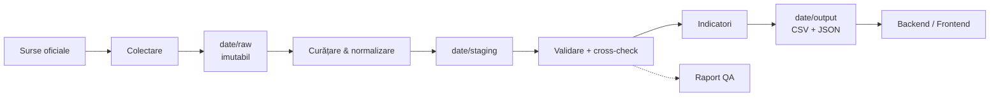

# Echipa Data Analysis — GalaBizz

> Manualul intern al echipei. Pentru contextul general al proiectului vezi README-ul din rădăcină.

---

## 1. Context proiect

Proiect master · FEEA Galați · E-Business · **Tema 2**: cele mai profitabile firme din România, ce lipsește în Galați și ce ar avea succes, specificul forței de muncă din Galați, cu verificare pe alte orașe.

Rezultatul final e o aplicație web (frontend + backend pe API-uri). **Noi producem datele** pe care se sprijină restul.

---

## 2. Misiunea echipei

### Livrăm

- Seturi de date curate, documentate și versionate (`date/output/`).
- Indicatori de profitabilitate și de oportunitate locală.
- Contractul de date către backend (secțiunea 9).
- Raport de acoperire + dicționar de date pentru QA.
- 5–10 concluzii-cheie cu cifre verificabile, pentru marketing și raport.

### NU livrăm

- UI, design vizual, hosting, infrastructură.
- Schema bazei de date a aplicației (doar propunem ce câmpuri avem nevoie).
- Interpretări fără date în spate.

### Regula de aur

> Fiecare cifră din aplicație trebuie să poată fi urmărită până la sursa primară.

---

## 3. Componența echipei

5 membri, identificați prin inițiale (anonimizat în repository).

| Membru | Rol principal | Ce face concret | Etapa |
|---|---|---|---|
| **T** | Inginerie de date | descarcă sursele, scrie parserii pentru bilanțuri, calculează indicatorii de profitabilitate | E1 + E3 |
| **A** | Calitatea datelor | curăță și normalizează (CUI, CAEN, județ, localitate), ține `surse.md` la zi, raport de acoperire | E2 |
| **E** | Forță de muncă & context local | INS TEMPO, populație, profilul economic al Galațiului, comparații județene | E4 |
| **F** | Piețe & benchmark | gap analysis, scor de oportunitate, comparația cu orașele benchmark | E5 |
| **R** | Raportare & interfață externă | grafice, textul raportului, dicționar de date, legătura cu QA/backend/marketing | E6 |

> Identitățile reale nu se trec în repo. Fiecare membru își asumă contribuția prin inițiala din tabel.

**Reguli de colaborare între roluri:**
- Fiecare rol e **owner**, nu singurul care poate lucra la etapa lui — dar răspunde de ea.
- T livră date parsate → A le curăță → E și F le folosesc → R le publică.
- Nimeni nu modifică formula unui indicator fără să anunțe owner-ul etapei.
- Când cineva e blocat, anunță în grup; nu stă cu etapa pe loc.

---

## 4. Flux intern de lucru

### Branch-uri

```
main                  ← doar integrări finale (nu lucrăm direct)
└── data-analysis     ← branch-ul echipei, integrare continuă
    ├── data/colectare-<subiect>
    ├── data/curatare-<subiect>
    └── data/indicatori-<subiect>
```

- Lucrăm pe `data-analysis`; sub-task-uri pe branch-uri scurte `data/...`.
- **Nu** facem push pe `main` și nu atingem branch-ul `frontend`.
- `data-analysis → main` se face doar la milestone (E3, E6), cu acordul celorlalte echipe.

### Commit-uri

Format: `tip: descriere la prezent`

| Tip | Când |
|---|---|
| `feat` | script nou, indicator nou, sursă nouă |
| `fix` | corectare de calcul, parser, date greșite |
| `docs` | documentație, dicționar de date |
| `data` | actualizare livrabile în `date/output/` |
| `chore` | config, `.gitignore`, structură |

Exemplu: `feat: parser bilanț MF pentru anul 2023`

### Review intern

- Orice script care produce livrabile e citit de încă un membru înainte de merge.
- Cine modifică formula unui indicator anunță înainte, nu după.

---

## 5. Ce acoperim: întrebările de cercetare

| # | Întrebare | Indicator | Owner |
|---|---|---|---|
| R1 | Top firme profitabile din RO | profit net, CA, marjă, CAEN, județ | **T** |
| R2 | Cele mai profitabile domenii | profit agregat + marjă mediană pe diviziune CAEN | **T** |
| R3 | Ce lipsește în Galați | densitate firme / 1.000 locuitori vs. benchmark | **F** |
| R4 | Ce ar avea succes în Galați | scor de oportunitate (gap × profitabilitate × forță de muncă) | **F** + **E** |
| R5 | Specificul forței de muncă | structură salariați, salariu mediu, șomaj | **E** |
| R6 | Comparație orașe | clasament multi-criteriu | **F** |

Orașe benchmark propuse: Iași, Constanța, Brăila, Bacău, Craiova, Cluj-Napoca, Timișoara.

---

## 6. Surse & unelte

Inventarul complet, cu status de validare: **[`surse.md`](surse.md)**.

Pe scurt, în ordinea importanței:
1. **MF/ANAF** — situații financiare anuale (sursa de adevăr).
2. **ONRC / ANAF** — identificare firmă, CAEN, stare.
3. **INS TEMPO** — salariați, salarii, șomaj, populație.
4. Agregatoare comerciale — **doar cross-check**, niciodată sursă primară.

Unelte: Python (`requests`, `pandas`, `lxml`), SQL pentru explorare, Jupyter pentru grafice, Git pentru versionare. Fără transformări manuale în Excel.

---

## 7. Metodologie & formule

### Profitabilitate

| Indicator | Formulă | Condiție |
|---|---|---|
| `marja_net` | `profit_net / cifra_afaceri` | `cifra_afaceri > 0` |
| `profit_per_angajat` | `profit_net / nr_salariati` | `nr_salariati > 0` |
| `ROA` | `profit_net / total_active` | `total_active > 0` |
| `ROE` | `profit_net / capitaluri_proprii` | `capitaluri_proprii > 0` |
| `crestere_ca` | `(CA_an − CA_an-1) / CA_an-1` | doi ani disponibili |

Filtre obligatorii pentru topuri: firmă activă, `cifra_afaceri > 0`, excluderea valorilor aberante documentate. Firmele fără bilanț depus = `null`, **nu** zero.

### Gap analysis Galați

```
densitate = nr_firme_caen / populatie * 1000
gap       = densitate_benchmark − densitate_galati
oportunitate = gap_normalizat × marja_medie_caen × factor_forta_munca
```

1. Densitate pe cod CAEN, la 1.000 locuitori, pentru Galați.
2. Aceeași densitate pentru benchmark (media urbană + orașe comparabile).
3. Gap mare + domeniu profitabil + forță de muncă disponibilă ⇒ **oportunitate**.

### Specificul forței de muncă

- Structura salariaților pe secțiuni CAEN.
- Salariu mediu vs. media națională și vs. orașele benchmark.
- Rată șomaj, populație activă.
- Concluzie: ce tip de afacere se potrivește cu forța de muncă existentă (Galați: metalurgie, port, construcții navale, logistică).

---

## 8. Pipeline



- `date/raw/` nu se modifică niciodată; se salvează cu data descărcării.
- Orice transformare e scriptată și reproductibilă.
- Fiecare livrabil are sursă + dată + versiune.

---

## 9. Contract de date cu backend

Formatul pe care îl livrăm (orice schimbare se anunță în avans):

```json
{
  "firma": {
    "cui": 12345678,
    "denumire": "EXEMPLU S.A.",
    "cod_caen": "2410",
    "caen_descriere": "Producția de metale feroase",
    "judet": "Galați",
    "localitate": "Galați",
    "an_fiscal": 2024,
    "cifra_afaceri": 0,
    "profit_net": 0,
    "marja_net": 0.0,
    "nr_salariati": 0,
    "profit_per_angajat": 0.0,
    "stare": "activa"
  },
  "indicator_local": {
    "localitate": "Galați",
    "cod_caen": "2410",
    "firme_la_1000_locuitori": 0.0,
    "benchmark": 0.0,
    "gap": 0.0,
    "scor_oportunitate": 0.0
  }
}
```

Reguli: `snake_case`; numere ca `number`, lipsă = `null`; `cui` = cheie primară; sume în **RON**; un endpoint = un tabel normalizat; agregările se calculează o singură dată (la noi sau la ei — de stabilit).

---

## 10. Convenții de lucru

- **Encoding** UTF-8, diacritice românești corecte.
- **CUI**: întreg, fără `RO`, fără spații, validat cu cifra de control.
- **CAEN**: păstrăm codul din sursă + câmp `caen_versiune`; mapare explicită Rev.2 → Rev.3, fără presupuneri.
- **Localitate/județ**: normalizate la nomenclatorul INS.
- **An fiscal**: 4 cifre; documentăm dacă e an de raportare sau de exercițiu.
- **Nume fișiere**: `sursa__continut__an__versiune.csv`.
- **Fără date personale** și fără credențiale în repo.

---

## 11. Structura folderelor noastre

```
date/
├── raw/          # descărcări brute, imutabile (git-ignored)
├── staging/      # date intermediare (git-ignored)
└── output/       # livrabile finale: CSV + JSON (în git)
scripts/          # colectare, curățare, indicatori
notebooks/        # explorare, grafice
documentatie/     # acest fișier, surse.md, dicționar de date
raport/           # materialul scris
```

---

## 12. Board de etape

| Etapa | Ce facem | Owner | Status |
|---|---|---|---|
| E1 | Validare surse, descărcare eșantion, definire schemă | **T** | 🟡 (linkuri confirmate de A) |
| E2 | Curățare + normalizare CUI/CAEN/localitate | **A** | ⬜ |
| E3 | Indicatori profitabilitate + topuri | **T** | ⬜ |
| E4 | Date INS + profil forță de muncă Galați | **E** | ⬜ |
| E5 | Gap analysis + benchmark orașe + scor oportunitate | **F** | ⬜ |
| E6 | Grafice, text raport, dicționar de date, predare backend/QA | **R** | ⬜ |

Legendă: ⬜ de început · 🟡 în lucru · ✅ gata · ⛔ blocat

**Dependențe:** E3 are nevoie de E1 → E2 are nevoie de E1 → E5 are nevoie de E2 + E4 → E6 are nevoie de E3 + E5.
Paralel posibil din start: **E1 (T)** și **E4 (E)** — nu depind una de alta.

---

## 13. Riscuri sub controlul nostru

| Risc | Mitigare |
|---|---|
| Formate MF/ANAF instabile între ani | parser versionat per an, testat pe 2 ani |
| CAEN Rev.2 vs Rev.3 | tabel de mapare explicit + câmp de versiune |
| Firme fără bilanț → topuri distorsionate | raport de acoperire, `null` în loc de zero |
| Suprapunere cu backend pe agregări | contract de date + un singur loc de calcul |
| Scraping blocat / rate-limit | preferăm bulk/API oficial, cache local, backoff |

---

## 14. Definition of Done

- [ ] Sursele documentate cu URL, licență, dată descărcare.
- [ ] Scripturile rulează cap-coadă pe un folder curat.
- [ ] `date/output/` respectă contractul de date.
- [ ] Dicționar de date complet.
- [ ] QA poate verifica manual 5 firme de top din sursa primară.
- [ ] Raport de acoperire pe fiecare an.
- [ ] Graficele din raport se regenerează din `date/output/`.
